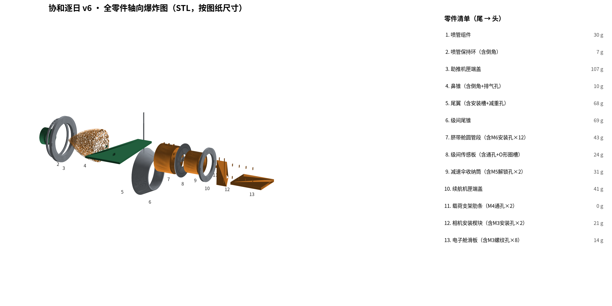
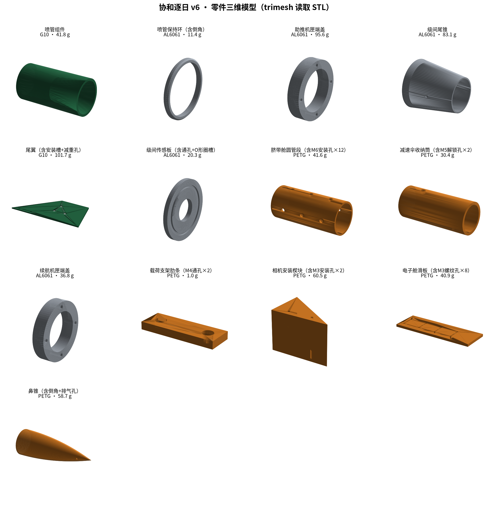

# eclipse-chaser

KNSB 两级探空火箭，追逐 **2035-09-02 日全食**（中国段）。仓库包含内弹道、飞行弹道、Besselian 月影几何、结构 FEA 与乘波体构型评估的完整仿真链。

## 1. 飞行器概要

| 项目 | 参数 |
|---|---|
| 推进剂 | KNSB（r = 5.164e-5·P^0.35, c* = 890 m/s） |
| 助推 | BATES 6 段，κ=20.5 mm，φ28 mm 喷管，mp = 5.21 kg，Isp≈127 s，燃时 1.58 s |
| 续航 | BATES 4 段，κ=13 mm，φ18 mm 喷管，mp = 1.15 kg，Isp≈126 s，燃时 1.27 s |
| 结构质量 | 助推 5.26 kg / 续航 1.65 kg / 载荷 1.0 kg（按 SF≥7 的 9/6 mm 壁重算） |
| 起飞质量 | 14.27 kg |
| BOM | ¥2990 |

### 1.1 三维模型





STL 由 `sim/stl_v2_detail.py` 生成（trimesh + manifold3d 真布尔，逐件校验水密/单壳体），`sim/render3d.py`（trimesh + matplotlib）负责离屏渲染。13 种 / 19 件，总质量 948.3 g。

## 2. 关键结论：4.5 min 全食不可达

用 NASA GSFC Besselian 根数（ΔT=80.6 s）独立复算 2035-09-02 月影（2 s 网格）：

| 地点 | 地面全食 |
|---|---|
| 北京 (40.15N, 115.85E) | 109 s（NASA 站值 110.8 s，偏差 2.5%） |
| 山海关 (40.00N, 119.60E) | 112 s |
| 北戴河 (39.80N, 119.40E) | 114 s |
| **秦皇岛海岸 (39.80N, 119.60E) —— v6 机位** | **115 s** |
| 黄海西部 (39.2N, 125.6E) | ~130 s（全球最长，不在国内陆地） |

- 机位处月影速度 **1290 m/s**、方位 **95.4°**，全食带沿轨宽度约 **148 km**。
- v5 报告的「火箭只有 88–95 s」是时长积分 bug（按记录条数×名义步长、实际步长漂移），修正后同一构型为 **121 s**；详见 [v6 报告](docs/v6_report_cn.md)。
- 270 s 需在窗口内持续沿轨 **740 m/s**：3 km 高度约需 1.84 MW / 497 MJ，而推进剂化学能仅 **2.5 MJ**，缺口约 **200 倍**。
- 乘波体在本量级推力下无增益（v6 复核：传统 123 s / 乘波体 117 s，后者弹道仅 1.9 km）。

**结论**：不出国、陆基发射的上限是 **123 s**（秦皇岛海岸 + 顺影飞行，45° 发射）。4.5 min 只能通过更换日食（2027-08-02 埃及，地面 6m23s）或气球/飞机平台实现。

## 3. 目录

```
sim/run_all.py        # v2 基线：内弹道 + 两自由度弹道 + Besselian + 寻优
sim/v6_chase.py       # v6：机位扫描 + 月影运动学 + 发射方位/角度/时刻联合寻优
sim/opt_v5_lift.py    # v5：乘波体气动模型（时长积分有 bug，结论以 v6 为准）
sim/opt_v2.py         # v2 参数寻优
sim/fea_v2.py         # PyTorch 有限元（机匣/螺纹/螺栓）
sim/stl*.py           # 零件 STL 生成
docs/                 # FEA 报告、零件清单、v6 报告、脱敏设计对话记录
data/                 # 求解结果 JSON/CSV（opt_v2、summary_v5、summary_v6 等）
figures/              # 弹道、应力、成本、骑影时间轴等图
```

## 4. 复现

环境固化在仓库内的 `env/`（已加入 `.gitignore`，随 workspace 快照保留，沙箱重置后无需重装）：

```bash
python3 -m venv env
env/bin/pip install -r requirements.txt
```

版本锁定见 `requirements.txt`。之后直接用 `env/bin/python` 运行，或 `source env/bin/activate`。

> 别用 `.venv/` 这个名字：工作区快照的 restic 忽略列表（`/app/etc/.resticignore`）会跳过 `.venv`、`node_modules`、`__pycache__` 等目录，放在里面重置后就没了。

```bash
env/bin/python sim/run_all.py        # v2 基线
env/bin/python sim/v6_chase.py       # v6 骑影方案，输出 data/summary_v6.json、figures/v6_ride.png
env/bin/python sim/opt_v5_lift.py    # v5 乘波体评估（历史对照）
env/bin/python sim/fea_v2.py         # FEA，输出 data/fea_results.json
env/bin/python sim/stl_v2_detail.py  # 生成 STL 与零件清单
env/bin/python sim/render3d.py       # trimesh 读取 STL，输出 figures/rocket_3d.png、parts_3d.png
```

依赖：numpy、matplotlib、torch（CPU，仅 FEA 需要）、trimesh、manifold3d、shapely、networkx、rtree、scipy；版本见 `requirements.txt`。
