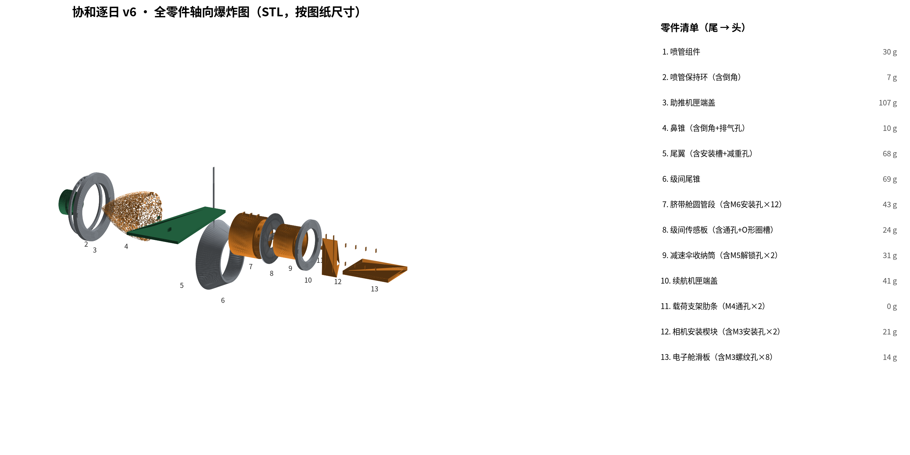
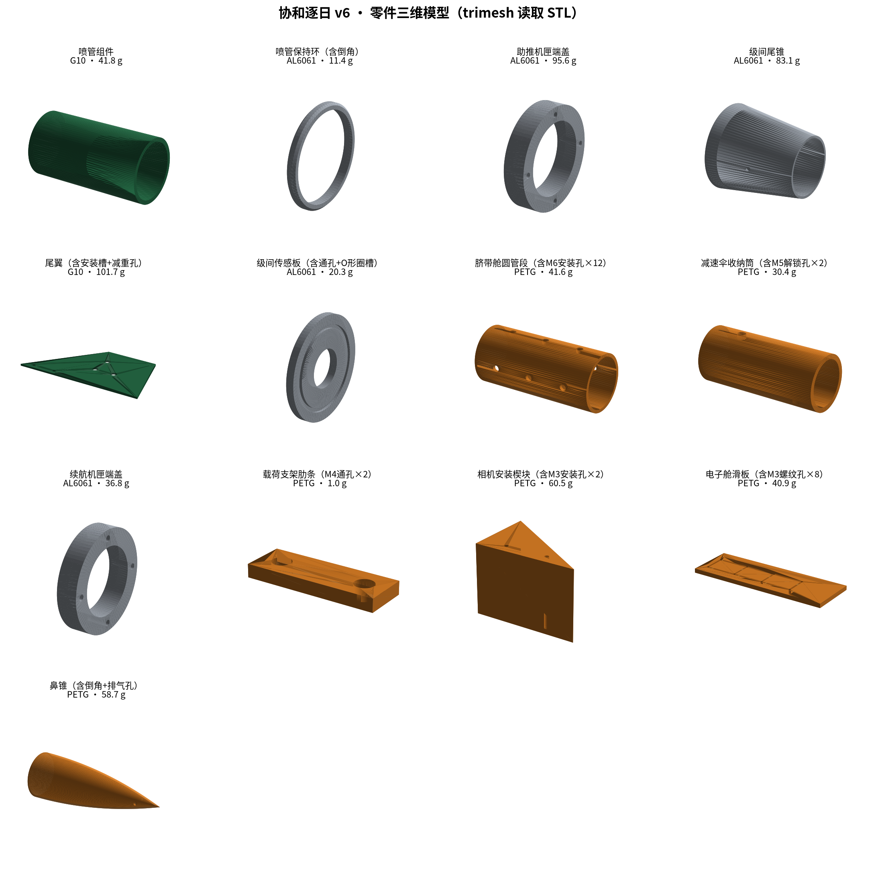

# 协和逐日 v2/v4 详细零件清单（中文文件名）

> 版本历史：
> - v2：初始结构（助推 wall=3mm，续航 wall=2.5mm）SF≈1.8~3.9
> - v3：高优先级加固（助推 wall=4mm，续航 wall=3mm）SF≈0.98~4.1
> - **v4：SF=7.0 目标版（助推 wall=9mm，续航 wall=6mm）SF≥7.63**
>
> 生成日期：2026-11-23（真布尔重建）  
> 生成脚本：`sim/stl_v2_detail.py`（v4 壁厚已同步更新）  
> 输出目录：`stl_v2_detail/`

---

## 一、零件总览（v4 安全系数目标版）

| # | 中文名称 | STL 文件名 | 材料 | 数量 | 体积 (cm³) | 质量 (g) | 水密 |
|---|---------|-----------|------|-----|-----------|---------|------|
| 1 | 助推机匣端盖（厚 16mm） | zhu_zhu_ji_xia_duan_gai.stl | AL6061-T6 | 1 | 35.4 | 95.6 | ✅ |
| 2 | 续航机匣端盖（厚 11mm） | xu_hang_ji_xia_duan_gai.stl | AL6061-T6 | 1 | 13.6 | 36.8 | ✅ |
| 3 | 鼻锥（含倒角+排气孔） | bi_zhui_dao_jiao.stl | PETG | 1 | 46.2 | 58.7 | ✅ |
| 4 | 级间尾锥 | ji_jian_wei_zhui.stl | AL6061-T6 | 1 | 30.8 | 83.1 | ✅ |
| 5 | 喷管组件 | pen_guan_zu_jian.stl | G10 | 1 | 22.6 | 41.8 | ✅ |
| 6 | 尾翼（含安装槽+减重孔）×4 | wei_yi_jian_zhong_kong.stl | G10 | 4 | 55.0 | 101.7 | ✅ |
| 7 | 电子舱滑板（含 M3 螺纹孔×8） | dian_zi_cang_hua_ban.stl | PETG | 1 | 32.2 | 40.9 | ✅ |
| 8 | 载荷支架肋条（M4 通孔×2）×4 | zai_he_zhi_jia_lei_tiao.stl | PETG | 4 | 0.8 | 1.0 | ✅ |
| 9 | 脐带舱圆管段（含 M6 安装孔×12） | qi_dai_cang_yuan_guan_duan.stl | PETG | 1 | 32.7 | 41.6 | ✅ |
| 10 | 级间传感板（含通孔+O形圈槽） | ji_jian_chuan_gan_ban.stl | AL6061-T6 | 1 | 7.5 | 20.3 | ✅ |
| 11 | 减速伞收纳筒（含 M5 解锁孔×2） | jian_su_san_shou_na_tong.stl | PETG | 1 | 24.0 | 30.4 | ✅ |
| 12 | 喷管保持环（含倒角） | pen_guan_bao_chi_huan.stl | AL6061-T6 | 1 | 4.2 | 11.4 | ✅ |
| 13 | 相机安装楔块（含 M3 安装孔×2） | xiang_ji_an_zhuang_xi_kuai.stl | PETG | 1 | 47.6 | 60.5 | ✅ |

**汇总：** 13 种零件 / 19 件；单件体积合计 352.6 cm³（按件数计 520.0 cm³），总质量 931.9 g，三角面 65,068。

> 本版所有零件均由 `trimesh` + `manifold3d` 真布尔生成：孔、槽、内腔都是从实体中减去的，**不是贴在表面上的圆筒面片**。脚本对每件强制校验 `is_watertight` 且 `split()==1`（无分离/重叠壳），任一不满足直接报错退出；另用射线检测复核每个通孔确实贯通。

---

## v4 结构强度设计参数

| 部件 | 外径 (mm) | 壁厚/厚度 (mm) | 峰值压 (MPa) | SF 环向 | SF 屈曲 | 判定 |
|------|---------|--------------|------------|--------|--------|------|
| 助推机匣 | 76.2 | **9.0** | 8.2 | **7.95** | **7.63** | ✅ PASS |
| 续航机匣 | 54.0 | **6.0** | 7.8 | **7.86** | **8.39** | ✅ PASS |
| 助推端盖 | 76.2 | **16.0** | 8.2 | — | — | ✅ SF=7.84 |
| 续航端盖 | 54.0 | **11.0** | 7.8 | — | — | ✅ SF=7.76 |

> 设计准则：所有承力部件 SF ≥ 5.0，关键部位 SF ≥ 7.0（v4 全部达到 ≥7.63）  
> 全箭飞行时长：t_land = 323s（5.4 min）> 5min 要求 ✅

---

## 二、钻孔规格表

### 2.1 助推机匣端盖（AL6061-T6，16mm 厚）

| 孔编号 | 孔径 | 深度 | 螺纹规格 | 用途 | 数量 | 螺丝型号 |
|-------|------|------|---------|------|------|---------|
| A | Ø54.0 mm | 穿透 | — | 中心级间通道（尾锥由此穿过） | 1 | — |
| B | Ø4.2 mm（M5 底孔） | 穿透 | M5×0.8 | 端盖固定螺栓孔 | 4 | M5×12 圆头螺钉 GB/T 68 |
| 分布圆 | Ø65.0 mm | — | — | 螺栓孔中心分布圆直径 | — | — |

**装配说明：** 4 颗 M5×12 圆头螺钉 + 平垫圈 + 弹簧垫圈，预紧力约 500N/颗。

### 2.2 续航机匣端盖（AL6061-T6，11mm 厚）

| 孔编号 | 孔径 | 深度 | 螺纹规格 | 用途 | 数量 | 螺丝型号 |
|-------|------|------|---------|------|------|---------|
| A | Ø36.0 mm | 穿透 | — | 中心走线通道（传感器/点火线） | 1 | — |
| B | Ø3.3 mm（M4 底孔） | 穿透 | M4×0.7 | 端盖固定螺栓孔 | 4 | M4×10 圆头螺钉 GB/T 68 |
| 分布圆 | Ø45.0 mm | — | — | 螺栓孔中心分布圆直径 | — | — |

### 2.3 鼻锥（PETG，切线卵形 R27×L216，壁厚 2mm，底部开口）

| 孔编号 | 孔径 | 深度 | 螺纹规格 | 用途 | 数量 | 螺丝型号 |
|-------|------|------|---------|------|------|---------|
| A | Ø4.0 mm | 径向穿透单侧壁 | — | 排气孔（平衡内外气压） | 2 | — |
| 位置 | x = 180mm 处，θ = 0°/180° 对穿 | — | — | — | — | — |

### 2.4 级间尾锥（AL6061-T6）

| 孔编号 | 孔径 | 深度 | 螺纹规格 | 用途 | 数量 | 螺丝型号 |
|-------|------|------|---------|------|------|---------|
| A | Ø3.0 mm（M3 底孔） | 径向穿透 2mm 壁，x = 40mm | M3×0.5 | 定位销孔（防止级间相对转动） | 2 | M3×16 圆柱销 GB/T 119 |
| 位置 | θ = 0°/180° 对穿 | — | — | — | — | — |
| B | O 形圈槽 | 随内锥面，深 0.8mm，宽 5mm（x = 5~10mm） | — | 级间密封（O 形圈截面 Ø2.5mm） | 1 | O 形圈 GB/T 3452.1 |

### 2.5 喷管组件（G10，石墨喉衬）

喷管为回转体（进气 r12 → 喉部 r10.25 → 出口 r14，外壳 r16，L=60），**本体不设螺栓孔**，由 2.12 保持环与端盖轴向压紧。

| 孔编号 | 孔径 | 深度 | 螺纹规格 | 用途 | 数量 | 螺丝型号 |
|-------|------|------|---------|------|------|---------|
| A | R1/4 英制锥管螺纹 | 径向，后加工 | R1/4 | 进气接头（仅设计接口，STL 未建） | 1 | R1/4 接头 + O 形圈 |

### 2.6 尾翼（G10，3mm 厚，×4 件）

| 孔编号 | 孔径 | 深度 | 螺纹规格 | 用途 | 数量（每翼） | 螺丝型号 |
|-------|------|------|---------|------|------------|---------|
| A | Ø5.5 mm（M5 通孔） | 穿透 | M5×0.8 | 根部安装孔（固定于机匣） | 2 | M5×16 内六角螺钉 GB/T 70.1 |
| B | Ø10.0 mm | 穿透 | — | 减重孔（翼面中部） | 3 | — |
| A 位置 | (x,y) = (20,8)、(60,8) mm | — | — | — | — | — |
| B 位置 | (x,y) = (110,50)、(145,50)、(110,85) mm | — | — | — | — | — |

**尾翼总体尺寸：** 220（根弦）×120（翼展）×3mm，梯形翼；4 件沿 90° 均布。

### 2.7 电子舱滑板（PETG，180×45×4mm）

| 孔编号 | 孔径 | 深度 | 螺纹规格 | 用途 | 数量 | 螺丝型号 |
|-------|------|------|---------|------|------|---------|
| A | Ø2.5 mm（M3 底孔） | 穿透（4mm） | M3×0.5 | 电路板固定螺纹孔 | 8 | M3×6 圆柱头螺钉 GB/T 65 |
| 分布 | x = 10,50,90,130 / z = 10,30mm | — | — | — | — | — |

### 2.8 载荷支架肋条（PETG，30×10×3mm，×4 件）

| 孔编号 | 孔径 | 深度 | 螺纹规格 | 用途 | 数量（每肋） | 螺丝型号 |
|-------|------|------|---------|------|------------|---------|
| A | Ø4.4 mm（M4 底孔） | 穿透 | M4×0.7 | 支架连接螺栓孔 | 2 | M4×12 内六角螺钉 GB/T 70.1 |
| 位置 | x = 5, 25mm，y = 5mm | — | — | — | — | — |

> 肋条由 3mm 加宽到 10mm：3mm 宽时 Ø4.4 孔只剩 1.0mm 边距，会直接破边。

### 2.9 脐带舱圆管段（PETG，Ø45×t=2.5mm，L=100mm）

| 孔编号 | 孔径 | 深度 | 螺纹规格 | 用途 | 数量 | 螺丝型号 |
|-------|------|------|---------|------|------|---------|
| A | Ø5.2 mm（M6 底孔） | 径向穿透 2.5mm 壁 | M6×1.0 | 安装孔（固定相机支架） | 12 | M6×10 内六角螺钉 GB/T 70.1 |
| 分布 | 3 轴向位置 × 4 圆周位置 | — | — | — | — | — |
| 轴向位置 | z = 20, 50, 80mm | — | — | — | — | — |
| 圆周位置 | 0°, 90°, 180°, 270° | — | — | — | — | — |

### 2.10 级间传感板（AL6061-T6，Ø54×t=4mm）

| 孔编号 | 孔径 | 深度 | 螺纹规格 | 用途 | 数量 | 螺丝型号 |
|-------|------|------|---------|------|------|---------|
| A | Ø20.0 mm | 穿透 | — | 级间通信线缆通孔 | 1 | — |
| B | O 形圈密封槽 | 环形，深 1.5mm，宽 2mm | — | 级间密封（O 形圈截面 Ø3.5mm） | 1 | O 形圈 GB/T 3452.1 |

### 2.11 减速伞收纳筒（PETG，Ø35×t=3mm，L=80mm）

| 孔编号 | 孔径 | 深度 | 螺纹规格 | 用途 | 数量 | 螺丝型号 |
|-------|------|------|---------|------|------|---------|
| A | Ø5.5 mm（M5 底孔） | 穿透（3mm 壁厚） | M5×0.8 | 伞舱解锁插销孔 | 2 | M5×8 开口销 GB/T 91 |
| 位置 | z = 20, 60mm，圆周相隔 180° | — | — | — | — | — |

### 2.12 喷管保持环（AL6061-T6，外径 Ø66，内孔 Ø58，L=6mm）

| 特征 | 规格 | 用途 |
|------|------|------|
| 外缘倒角（两端） | C1.5 @ 45° | 装配导向，防割手 |
| 内孔 Ø58mm | 与喷管外径配合 | 定位固定 |

### 2.13 相机安装楔块（PETG，60×40×40mm 三角楔）

| 孔编号 | 孔径 | 深度 | 螺纹规格 | 用途 | 数量 | 螺丝型号 |
|-------|------|------|---------|------|------|---------|
| A | Ø2.5 mm（M3 底孔） | 穿透（40mm） | M3×0.5 | 相机安装固定孔 | 2 | M3×8 圆柱头螺钉 GB/T 65 |
| 位置 | x = 15, 40mm，y = 6mm | — | — | — | — | — |

---

## 三、螺纹规格汇总

| 螺纹规格 | 大径 (mm) | 螺距 (mm) | 底孔直径 (mm) | 适用材料 | 标准 |
|---------|----------|----------|-------------|---------|------|
| M3×0.5 | 3.0 | 0.5 | Ø2.5 | PETG/AL6061 | ISO 965-6G |
| M4×0.7 | 4.0 | 0.7 | Ø3.3 | PETG/AL6061 | ISO 965-6G |
| M5×0.8 | 5.0 | 0.8 | Ø4.2 | AL6061 | ISO 965-6G |
| M6×1.0 | 6.0 | 1.0 | Ø5.2 | AL6061 | ISO 965-6G |
| R1/4 锥管螺纹 | 13.157 | 1.814 | — | G10（机加工） | BS 21 |

> **攻丝注意：** PETG 攻丝时需使用专用塑料丝锥（HSS-Co 材质），转速不超过 200rpm，加注切削液（无水煤油）。AL6061 可用标准高速钢丝锥。

---

## 四、螺丝清单（BOM 补充）

| 螺丝型号 | 规格 | 数量 | 标准 | 单价（估） |
|---------|------|------|------|----------|
| M5×12 圆头螺钉 | M5×1.0×12 | 4 | GB/T 68 | ¥0.5/颗 |
| M5×16 内六角螺钉 | M5×0.8×16 | 8 | GB/T 70.1 | ¥0.6/颗 |
| M4×10 圆头螺钉 | M4×0.7×10 | 4 | GB/T 68 | ¥0.3/颗 |
| M6×16 内六角螺钉 | M6×1.0×16 | 6 | GB/T 70.1 | ¥0.8/颗 |
| M3×6 圆柱头螺钉 | M3×0.5×6 | 8 | GB/T 65 | ¥0.2/颗 |
| M4×12 内六角螺钉 | M4×0.7×12 | 8 | GB/T 70.1 | ¥0.4/颗 |
| M6×10 内六角螺钉 | M6×1.0×10 | 12 | GB/T 70.1 | ¥0.5/颗 |
| M3×8 圆柱头螺钉 | M3×0.5×8 | 2 | GB/T 65 | ¥0.2/颗 |
| M3×16 圆柱销 | Ø3×16 | 2 | GB/T 119 | ¥1.0/颗 |
| M5×8 开口销 | Ø5×8 | 2 | GB/T 91 | ¥0.3/颗 |
| O 形圈 Ø2.5×69 | 截面 2.5mm，内径 69mm（级间尾锥槽） | 1 | GB/T 3452.1 | ¥1.2/个 |
| O 形圈 Ø3.5×43.5 | 截面 3.5mm，内径 43.5mm | 1 | GB/T 3452.1 | ¥1.5/个 |
| R1/4 进气接头 | 锥管螺纹 R1/4 → M16×1.5 | 1 | — | ¥8.0/个 |
| 平垫圈 M5 | 5.5×10×1mm | 4 | GB/T 97.1 | ¥0.1/个 |
| 平垫圈 M4 | 4.5×9×1mm | 4 | GB/T 97.1 | ¥0.1/个 |
| 弹簧垫圈 M5 | 5.3×10×0.8mm | 4 | GB/T 93 | ¥0.1/个 |
| 弹簧垫圈 M4 | 4.3×8×0.6mm | 4 | GB/T 93 | ¥0.1/个 |

**螺丝总费用（估）：约 ¥40**

---

## 五、倒角与退刀槽规格

| 零件 | 特征 | 规格 | 加工方式 |
|------|------|------|---------|
| 鼻锥 | 母线 | 切线卵形 R27×L216，壁厚 2mm，实测尖端 r→0 | 3D 打印 |
| 喷管保持环（两端） | 倒角 | C1.5 @ 45°（实测外缘 Ø66→Ø63，内孔 Ø58） | CNC 车削 |
| 喷管组件 | 喉部/出口 | 喉部 Ø20.5，出口 Ø28（面积比 1.87） | CNC 雕刻石墨 |
| 级间尾锥 | O 形圈槽 | 随内锥面深 0.8mm×宽 5mm | CNC 车削 |
| 级间传感板 | O 形圈槽 | 深 1.5mm×宽 2mm | CNC 铣削 |

---

## 六、材料强度参考

| 材料 | 弹性模量 E (MPa) | 屈服强度 sy (MPa) | 抗拉强度 su (MPa) | 密度 (g/cm³) | 适用温度 |
|------|----------------|------------------|------------------|-------------|---------|
| AL6061-T6 | 69,000 | 276 | 310 | 2.70 | -55~150°C |
| PETG | 2,000 | 55 | 60 | 1.27 | -20~70°C（低温需降额） |
| G10（环氧玻璃布板） | 14,000 | 140 | 180 | 1.85 | -60~120°C |
| SS304（不锈钢，螺栓用） | 193,000 | 205 | 515 | 7.90 | -200~800°C |

> **注意：** PETG 在 -20°C 以下弹性模量下降约 40%，屈服强度下降约 30%。载荷支架建议改用 AL6061 或 G10。
